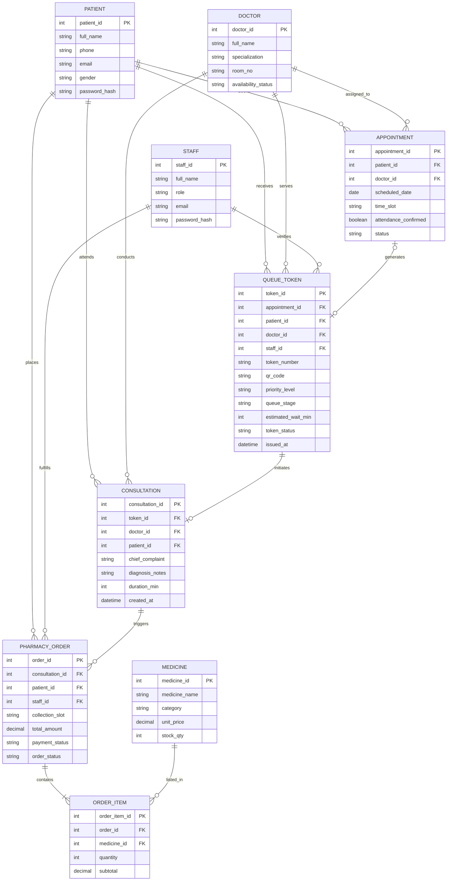
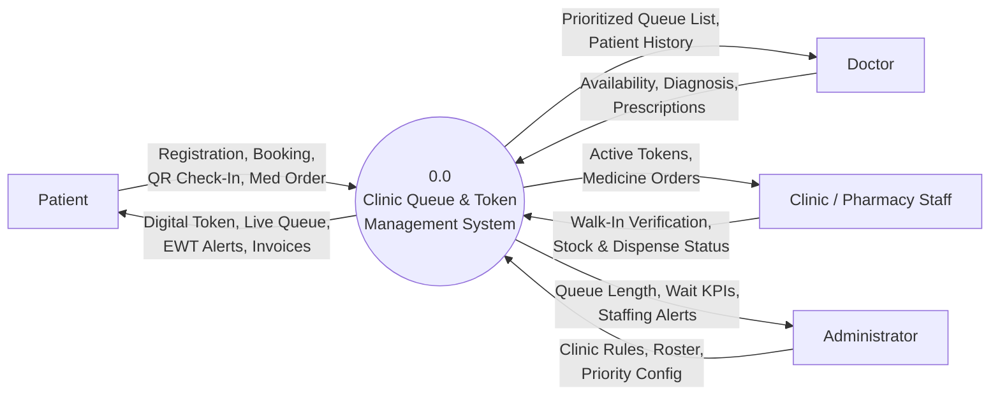
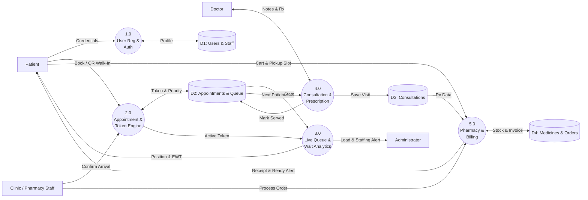
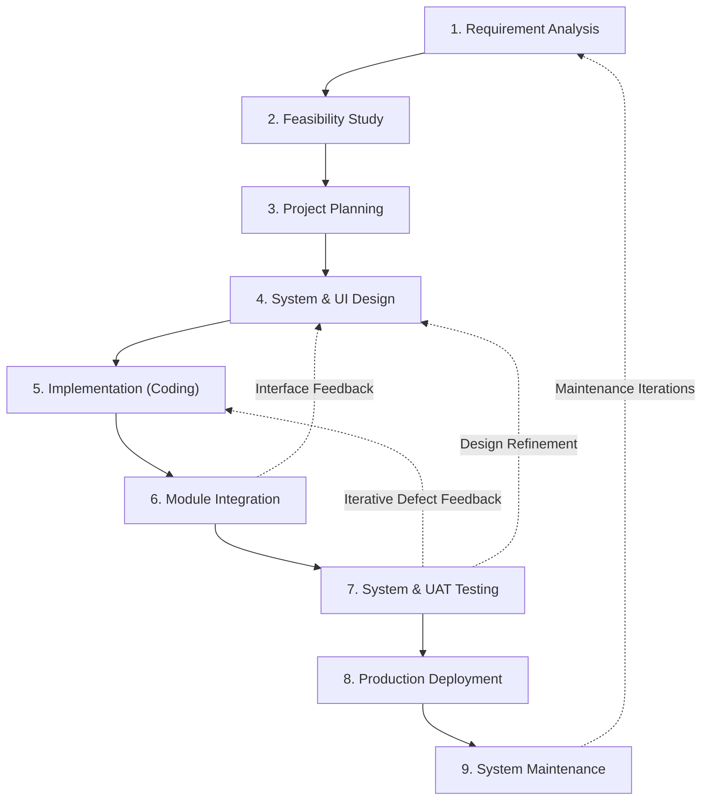

<!-- ==================== PAGE 1: FRONT PAGE (ADAMAS UNIVERSITY) ==================== -->

<h1 style="font-family: 'Algerian', 'Times New Roman', serif; font-size: 26pt; color: #1E3A5F; margin-bottom: 4mm; letter-spacing: 1px;">
ADAMAS UNIVERSITY
</h1>

  

  <h3 style="margin: 0; color: #111827; font-size: 14pt; letter-spacing: 1px;">END-SEMESTER PRACTICAL FILE</h3>
  
Software Engineering Laboratory

 

<table class="details-table">
  <tr>
    <td class="label">Name:-</td>
    <td class="val">Kamruzzaman Mondal</td>
  </tr>
  <tr>
    <td class="label">Roll No:-</td>
    <td class="val">UG/SOET/30/24/168</td>
  </tr>
  <tr>
    <td class="label">Registration No.:-</td>
    <td class="val">AU/2024/0000673</td>
  </tr>
  <tr>
    <td class="label">Program:-</td>
    <td class="val">B.TECH (COMPUTER SCIENCE AND ENGINEERING)</td>
  </tr>
  <tr>
    <td class="label">SEMESTER:-</td>
    <td class="val">5th</td>
  </tr>
  <tr>
    <td class="label">SUBJECT NAME:-</td>
    <td class="val">SOFTWARE ENGINEERING</td>
  </tr>
  <tr>
    <td class="label">SUBJECT CODE:-</td>
    <td class="val">CSE11117</td>
  </tr>
  <tr>
    <td class="label">SCHOOL:-</td>
    <td class="val">SCHOOL OF ENGINEERING AND TECHNOLOGY</td>
  </tr>
  <tr>
    <td class="label">SESSION:-</td>
    <td class="val">2026-27</td>
  </tr>
</table>

<!-- ==================== PAGE 2: TITLE PAGE ==================== -->

### END-SEMESTER PRACTICAL REPORT

 

# **Title**

## **Clinic Queue and Token Management System (CQTMS)**
### *A Centralized System for Efficient Patient Flow, Priority Routing, and Integrated Outpatient Healthcare Management*

  

*Submitted in partial fulfillment of the requirements for the End-Semester Practical Assessment in* 
**Software Engineering Lab (CSE11117)** 
*for the award of the degree of* 
**Bachelor of Technology in Computer Science & Engineering**

  

**Submitted By:** 
**KAMRUZZAMAN MONDAL** 
Roll No.: **UG/SOET/30/24/168** &nbsp;|&nbsp; Registration No.: **AU/2024/0000673**

  

**Department of Computer Science & Engineering** 
**School of Engineering and Technology** 
**Adamas University, Kolkata, West Bengal** 
**Academic Session: 2026 – 2027**

<!-- ==================== PAGE 3: ABSTRACT ==================== -->

## Abstract

Managing patient flow in outpatient clinics has always been a challenge, with long wait times causing frustrated patients and a less efficient clinic. To address this problem, many healthcare facilities are shifting toward the digital **Clinic Queue and Token Management System (CQTMS)**. This review looks at three recent studies to see how these modern queue systems impact both the clinic's day-to-day operations and the patient's experience. In particular, the study examines online queue monitoring, the application of artificial intelligence to anticipate and reduce waiting times, and ways to improve the flow of patients in walk-in clinics.

The research in total shows that the transition from manual paper-based queues to automated token systems significantly improves operational workflow. Quantitative analysis demonstrates that the combination of AI forecasting and online check-ins significantly reduces actual waiting time through dynamic resource allocation and the routing of patients through registration, consultation, and pharmacy processes.

Furthermore, such systems can handle high-volume walk-in traffic with the aid of priority-based algorithms instead of inflexible first-come, first-served (FCFS) models. The studies also demonstrate a huge improvement in the patient experience: real-time visibility of queues dramatically reduces perceived waiting times and mitigates patient anxiety. To summarize, the development of an integrated Clinic Queue and Token Management System is a great step toward the modernization of healthcare administration. Streamlined patient flow, AI-based predictive scheduling, and transparency improve clinical efficiency and establish a structured, equitable, and patient-centric healthcare environment.

**Keywords:** *Clinic Queue Management, Digital Token System, Outpatient Workflow, Real-Time Queue Visibility, AI Pre-Screening, Walk-In Optimization, Healthcare Informatics.*

---

### Key References Evaluated

1. **Fauzi, N. A. M., & Suhaimi, N. H. S. (2025).** *Design and Evaluation of QKlinik: A Web-Based Queue Management System for Outpatient Clinics.* International Journal of Software Engineering and Computer Systems (IJSECS), 11(2), 147–159.
2. **Li, X., Tian, D., Li, W., et al. (2022).** *Using Artificial Intelligence to Reduce Queuing Time and Improve Satisfaction in Pediatric Outpatient Service: A Randomized Clinical Trial.* Frontiers in Pediatrics, 10:929834.
3. **Safdar, K. A., Emrouznejad, A., & Dey, P. K. (2020).** *An Optimized Queue Management System to Improve Patient Flow in the Absence of Appointment System.* International Journal of Health Care Quality Assurance, 33(7/8), 477–494.

<!-- ==================== PAGE 4: INTRODUCTION ==================== -->

## 1. Introduction

Outpatient departments (OPDs) and neighborhood clinics serve as the primary point of care for large patient populations, yet managing patient flow remains one of the most persistent administrative bottlenecks in healthcare delivery. Under conventional paper-based or semi-manual numbering systems, patients must arrive early and remain physically present in crowded waiting halls simply to hold their place in line. During peak hours—when a small team of physicians must attend to high, unpredictable patient arrivals—waiting areas become congested, increasing physical discomfort, staff stress, and the risk of infection transmission.

Healthcare digitalization addresses these bottlenecks by replacing manual slips with a unified **Clinic Queue and Token Management System (CQTMS)**. A modern web-based CQTMS streamlines the entire outpatient journey—from remote appointment booking and QR-code walk-in check-in to live token tracking, consultation management, and integrated pharmacy dispensing—within a single accessible platform. Rather than waiting passively without status updates, patients can monitor their real-time queue position and estimated waiting time (EWT) remotely, arriving close to their actual consultation window.

The architecture and design of the proposed CQTMS draw directly upon empirical insights from three complementary research pillars:

- **Integrated Web & Pharmacy Queuing (`QKlinik`):** Fauzi and Suhaimi (2025) demonstrated that combining QR-based queue registration, real-time status monitoring, and integrated online medicine ordering with downloadable invoicing bridges the gap between consultation and post-treatment pharmacy pickup—achieving an estimated **28% reduction in mean waiting time** (from 45–60 minutes to ~35 minutes) and a **4.78/5 usability rating**.
- **AI-Assisted Pre-Consultation Triage (`Smart-doctor`):** Li et al. (2022) conducted a randomized clinical trial on **626 pediatric outpatients** using a QR-triggered AI pre-inquiry tool that recommends preliminary tests before the physician visit. This workflow reduced median queuing time to **8.78 minutes** (*p* < 0.01), shortened total visit duration from **110.40 to 40.20 minutes**, and improved overall patient satisfaction by **17.53%**.
- **Dynamic Walk-In Queue Optimization (`Queuing-DEA`):** Safdar et al. (2020) studied a busy public OPD operating without appointment systems, where average wait times reached **168 minutes** (with an average queue length of 30 patients and severe morning surges). By applying output-oriented Data Envelopment Analysis (DEA) to live queue lengths and wait times, their framework continuously determines the required number of doctors and personnel to prevent excessive queue buildup.

Building on these findings, the proposed CQTMS establishes a scalable, patient-centric platform that balances appointment scheduling, walk-in triage, live transparency, and end-to-end clinical coordination.

<!-- ==================== PAGE 5: PROBLEM STATEMENT ==================== -->

## 2. Problem Statement

Despite advances in hospital administration software, many small-to-medium clinics and high-volume outpatient departments still rely on manual paper tokens, verbal calling, or disconnected point tools. This creates severe operational inefficiencies for healthcare staff and high frustration for patients. Specifically, the core problems addressed by this project are:

1. **Prolonged and Unpredictable Waiting Times:**
   Manual queue administration frequently results in outpatient waiting times of **45–60 minutes** in routine clinics and an average of **168 minutes** (exceeding 2.5 hours in peak surges) in walk-in public OPDs. Uncoordinated early-morning patient arrival surges overwhelm limited physician availability before additional doctors join later shifts.

2. **Mandatory Physical Presence & Waiting-Room Overcrowding:**
   Traditional paper token slips require patients to remain inside the clinic premises for the entire waiting period. This poses significant hardship for elderly patients, individuals with disabilities, working professionals, and families with young children, while increasing waiting-room congestion.

3. **Inflexibility of Strict First-Come, First-Served (FCFS) Queuing:**
   Manual FCFS queues cannot dynamically prioritize urgent medical cases, senior or vulnerable patients, or same-day post-test return consultations without causing confusion, perceived unfairness, or manual queue disruptions.

4. **Fragmented Clinical Workflows Across Departments:**
   Existing queue tools often operate as standalone display boards without integrating **registration, doctor consultation, and pharmacy dispensing**. Patients are forced to join separate physical lines at the reception desk, doctor's cabin, billing counter, and pharmacy window.

5. **Lack of Real-Time Queue Transparency & Missed-Turn Penalties:**
   Without live queue visibility or proactive turn alerts, patients experience anxiety over when they will be called. Stepping away briefly often causes patients to miss their turn—triggering re-queuing delays and sharp drops in patient satisfaction.

6. **Limited Staffing Visibility & Accessibility Barriers:**
   Clinic administrators lack real-time metrics (live queue length, average wait duration, and stage bottlenecks) to adjust doctor or pharmacist allocation proactively, while overly complex digital interfaces alienate elderly or low-digital-literacy users.

**Problem Summary:** *There is a clear need for an integrated, user-friendly, web-based Clinic Queue and Token Management System that unifies QR/online token generation, priority-aware queue routing, real-time waiting visibility, pharmacy integration, and live workload analytics to reduce outpatient wait times and improve service quality.*

<!-- ==================== PAGE 6: OBJECTIVES ==================== -->

## 3. Objectives

### Primary Aim
To design, model, and develop a unified, web-based **Clinic Queue and Token Management System (CQTMS)** that streamlines outpatient flow from check-in to pharmacy collection, minimizes actual and perceived waiting times, and provides administrators with real-time queue visibility and operational control.

### Specific Objectives

1. **To provide secure patient and staff authentication:** Maintain accurate patient profiles, doctor availability, and role-based permissions in a centralized relational database.
2. **To automate digital registration & token generation:** Replace manual paper slips with an online appointment booking and QR-code walk-in check-in module.
3. **To provide real-time queue tracking & EWT updates:** Display currently served tokens, live queue positions, and estimated waiting times to reduce anxiety and waiting hall crowding.
4. **To implement priority-aware queue routing:** Balance urgent triage, senior citizens, and returning post-lab patients alongside standard walk-ins instead of rigid FCFS ordering.
5. **To integrate consultation and digital prescriptions:** Enable physicians to record diagnoses, complaints, and digital prescriptions connected directly to subsequent stages.
6. **To unify pharmacy dispensing and collection:** Allow patients to review prescribed medicines, choose pickup slots, settle bills, and download itemized invoices.
7. **To supply real-time operational analytics for administrators:** Monitor active queue lengths, stage delays, and doctor workload to dynamically allocate clinical staff.
8. **To verify system performance via structured testing:** Validate data integrity, role authorization, and queue concurrency through Black-Box and User Acceptance Testing (UAT).

### Objective-to-Module Mapping

| Obj. | System Module | Target Users | Expected Outcome |
| :--- | :--- | :--- | :--- |
| **O1** | Role-Based Auth & Profiles | All Users | Secure access & segregated patient/staff data |
| **O2** | Online Booking & QR Token Engine | Patients, Reception | Eliminates physical queues & manual paper slips |
| **O3** | Live Queue Dashboard & EWT Tracker | Patients, Staff | Transparent waiting times & reduced anxiety |
| **O4** | Priority & Walk-In Queue Router | Reception, Doctors | Equitable triage for seniors & emergency cases |
| **O5** | Consultation & E-Prescription Portal | Doctors | Direct clinical diagnosis & prescription handover |
| **O6** | Integrated Pharmacy & Invoicing | Pharmacists, Patients | Seamless medicine ordering & collection slots |
| **O7** | Queue Load & Staffing Analytics | Administrators | Proactive bottleneck detection & doctor roster control |
| **O8** | QA Test Suite & Usability Audits | All Stakeholders | High data accuracy, concurrency & system stability |

<!-- ==================== PAGE 7: ENTITY RELATIONSHIP DIAGRAM (ERD) ==================== -->

## 4. System Design: Entity Relationship Diagram (ERD)

The relational database schema for the **Clinic Queue and Token Management System** is normalized to connect patient profiles, doctor availability, staff verification, scheduled appointments or walk-in queue tokens, clinical consultations, and integrated pharmacy orders without data redundancy.

**Schema Notes:** The optional one-to-one relation (`|o--o|`) between `APPOINTMENT` and `QUEUE_TOKEN` accommodates both pre-booked appointments and unscheduled walk-in patients. `QUEUE_TOKEN` tracks clinical stage (`Registration`, `Consultation`, `Pharmacy`) and priority tier (`Emergency`, `Senior`, `Returning`, `Normal`).

<!-- ==================== PAGE 8: DATA FLOW DIAGRAMS (LEVEL 0 & LEVEL 1) ==================== -->

## 5. System Design: Data Flow Diagrams (Level 0 & Level 1)

### 5.1 Context Diagram (Level 0 DFD)
Illustrates the external entities interacting with the centralized CQTMS process (`0.0`).

### 5.2 Level 1 Data Flow Diagram
Decomposes `0.0` into five core functional processes (`1.0`–`5.0`) backed by four persistent data stores (`D1`–`D4`).

**DFD Notation:** Rectangles = External Entities | Circles = Processes | Open Cylinders (`D1`–`D4`) = Data Stores | Arrows = Data Flows.

<!-- ==================== PAGE 9: SUITABLE MODEL (ITERATIVE WATERFALL MODEL) ==================== -->

## 6. Suitable Model for Clinic Queue and Token Management System

### 6.1 Selection of the Iterative Waterfall Model
The **Iterative Waterfall Model** is the most suitable Software Development Life Cycle (SDLC) model for the **Clinic Queue and Token Management System (CQTMS)**. The project has clearly defined clinical requirements, strict healthcare data dependencies, and multiple interconnected functional modules (appointment booking, QR token issuing, live queue tracking, consultation recording, and pharmacy dispensing).

Unlike the rigid Classical Waterfall model where requirements are completely frozen upfront, the **Iterative Waterfall Model provides a structured development path across nine systematic phases** while allowing developers to return to previous phases when errors, algorithmic adjustments, or clinical feedback are identified. For example, if during the testing phase of queue sequencing or estimated wait-time calculation an issue is discovered, developers can easily iterate back to the design or implementation phase to adjust the priority weighting or database schema without compromising the overall project integrity.

### 6.2 Key Advantages of Iterative Waterfall for CQTMS

1. **High Process Discipline & Traceability:** Each phase delivers explicit documentation (SRS, ERD, DFD, Test Reports) essential for healthcare information systems.
2. **Error Detection with Feedback Loops:** Permits returning to requirement, design, or coding phases upon detecting queue synchronization or concurrency bugs.
3. **Manageable Phase Boundaries:** Enables modular verification before integrating complex pharmacy billing and doctor consultation sub-systems.
4. **Appropriate for Academic & Practical Evaluation:** Demonstrates systematic adherence to established Software Engineering principles (as per Sommerville and Pressman).

<!-- ==================== PAGE 10: EXPLANATION OF ALL 9 PHASES ==================== -->

## 7. Explanation of all 9 Phases

The development of the **Clinic Queue and Token Management System (CQTMS)** progresses through nine sequential and iterative phases. The table below outlines each phase alongside its specific clinical and technical activities:

| PHASE | Activities in Clinic Queue & Token Management System |
| :--- | :--- |
| **1. Requirement Analysis** | Identify patient, doctor, clinic staff, pharmacist, and administrator workflow requirements. |
| **2. Feasibility Study** | Check technical, economic, and operational feasibility of web-based QR queuing & pharmacy integration. |
| **3. Planning** | Decide project timeline, database resource allocation, security protocols, and development schedule. |
| **4. Design** | Prepare ERD, DFD Level 0, DFD Level 1, relational database schema, and responsive UI wireframes. |
| **5. Implementation** | Develop login, appointment booking, QR token generation, live queue board, and pharmacy modules. |
| **6. Integration** | Connect user interfaces with the central database, queue management engine, and invoicing service. |
| **7. Testing** | Test authentication, priority routing (Emergency/Senior/Walk-In), EWT calculations, and payment checkout. |
| **8. Deployment** | Install and launch the web system for clinic reception counters, doctor cabins, and waiting-room displays. |
| **9. Maintenance** | Fix operational errors, update doctor availability rosters, maintain medicine stocks, and improve features. |

### Detailed Phase Summary

- **Phases 1–3 (Analysis & Planning):** Capture functional needs such as multi-tier token priority, walk-in registration, and estimate wait times to ensure operational viability without requiring expensive proprietary hardware.
- **Phases 4–6 (Design & Integration):** Construct normalized relational tables (Patient, Token, Doctor, Order) and link front-end Vue/React/HTML interfaces to Node/Python API backends with WebSocket live queue updates.
- **Phases 7–9 (Testing to Maintenance):** Validate concurrency under peak morning OPD rushes (Black-Box & UAT testing), deploy to clinic premises, and perform routine schema and roster updates.

