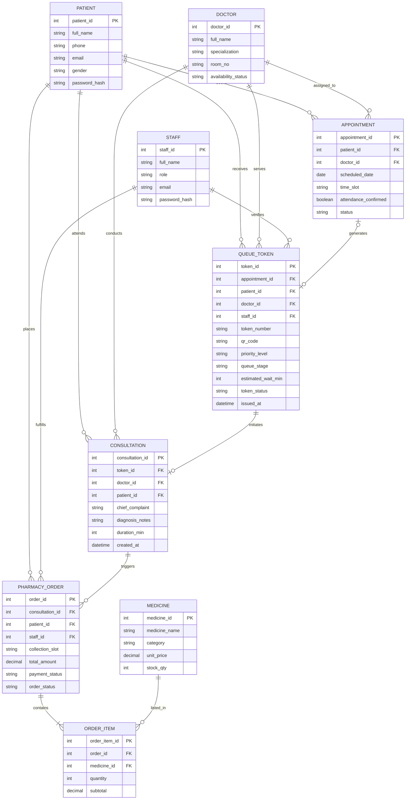
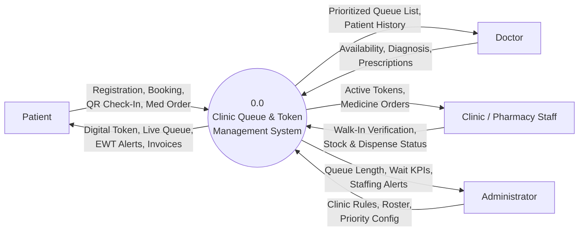
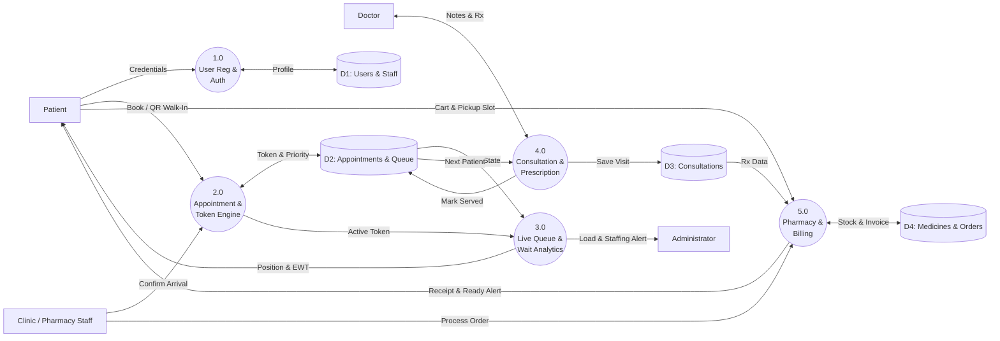
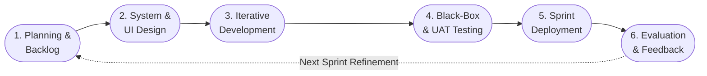

<!-- ==================== PAGE 1: FRONT PAGE (USER PROVIDED) ==================== -->

### [Page 1 — Front / Cover Page]

*Reserved for the official institute/college front cover page to be attached or inserted by the student prior to binding.*

*(If printing Pages 2–10 after attaching your separate cover sheet, print page range `2-10`, or replace this section with your cover page content before exporting to PDF.)*

<!-- ==================== PAGE 2: TITLE PAGE ==================== -->

### A PROJECT REPORT ON

 

# **Clinic Queue and Token Management System (CQTMS)**

#### *Design, Optimization, and Workflow Integration for Outpatient Healthcare Services*

  

*Submitted in partial fulfillment of the requirements for the award of the degree of* 
**[Degree Name — e.g., Bachelor of Technology / Bachelor of Science]** 
*in* 
**[Branch / Specialization — e.g., Computer Science & Engineering]**

  

**Submitted By:** 
**[Student Full Name]** 
Roll / Registration No.: **[Roll Number / Enrollment ID]**

 

**Under the Guidance of:** 
**[Guide / Supervisor Name]** 
**[Designation, Department]**

  

**[Department Name]** 
**[College / Institution / University Name]** 
**[City, State — PIN Code]** 
**[Month, Year — e.g., November 2026]**

<!-- ==================== PAGE 3: ABSTRACT ==================== -->

## Abstract

Managing patient flow in outpatient clinics has always been a challenge, with long wait times causing frustrated patients and a less efficient clinic. To address this problem, many healthcare facilities are shifting toward a digital **Clinic Queue and Token Management System (CQTMS)**. This project synthesizes findings from three foundational studies to design an integrated queue system that improves both a clinic's day-to-day operations and the overall patient experience—specifically examining web-based queue monitoring, artificial intelligence (AI) to anticipate and reduce waiting times, and dynamic optimization strategies for walk-in clinics without formal appointment systems.

Research evidence shows that transitioning from manual paper-based queues to automated digital token systems significantly improves operational workflow. Combining online QR-based check-ins with AI-assisted pre-screening and forecasting reduces actual waiting time by routing patients efficiently across registration, consultation, diagnostics, and pharmacy stages. Furthermore, automated queue systems manage high-volume walk-in traffic more effectively through priority-based routing and dynamic staff allocation models rather than rigid first-come, first-served (FCFS) queues.

Equally important is the improvement in patient experience: real-time visibility of queue positions and estimated wait times dramatically lowers perceived waiting times, prevents missed turns, and mitigates patient anxiety. In summary, an integrated Clinic Queue and Token Management System represents a practical modernization of outpatient healthcare administration—delivering streamlined patient flow, transparent scheduling, and a structured, equitable, patient-centric clinical environment.

**Keywords:** *Clinic Queue Management, Digital Token System, Outpatient Workflow, Real-Time Queue Tracking, AI Pre-Screening, Walk-In Optimization, Healthcare Informatics.*

---

### Key References Evaluated

1. **Fauzi, N. A. M., & Suhaimi, N. H. S. (2025).** *Design and Evaluation of QKlinik: A Web-Based Queue Management System for Outpatient Clinics.* International Journal of Software Engineering and Computer Systems (IJSECS), 11(2), 147–159.
2. **Li, X., Tian, D., Li, W., et al. (2022).** *Using Artificial Intelligence to Reduce Queuing Time and Improve Satisfaction in Pediatric Outpatient Service: A Randomized Clinical Trial.* Frontiers in Pediatrics, 10:929834.
3. **Safdar, K. A., Emrouznejad, A., & Dey, P. K. (2020).** *An Optimized Queue Management System to Improve Patient Flow in the Absence of Appointment System.* International Journal of Health Care Quality Assurance, 33(7/8), 477–494.

<!-- ==================== PAGE 4: INTRODUCTION ==================== -->

## 1. Introduction

Outpatient departments (OPDs) and neighborhood clinics serve as the primary point of care for large patient populations, yet managing patient flow remains one of the most persistent administrative bottlenecks in healthcare delivery. Under conventional paper-based or semi-manual numbering systems, patients must arrive early and remain physically present in crowded waiting halls simply to hold their place in line. During peak hours—when a small team of physicians must attend to high, unpredictable patient arrivals—waiting areas become congested, increasing physical discomfort, staff stress, and the risk of nosocomial infection transmission.

Healthcare digitalization addresses these bottlenecks by replacing manual slips with a unified **Clinic Queue and Token Management System (CQTMS)**. A modern web-based CQTMS streamlines the entire outpatient journey—from remote appointment booking and QR-code walk-in check-in to live token tracking, consultation management, and integrated pharmacy dispensing—within a single accessible platform. Rather than waiting passively without status updates, patients can monitor their real-time queue position and estimated waiting time (EWT) remotely, arriving close to their actual consultation window.

The architecture and design of the proposed CQTMS draw directly upon empirical insights from three complementary research pillars:

- **Integrated Web & Pharmacy Queuing (`QKlinik`):** Fauzi and Suhaimi (2025) demonstrated that combining QR-based queue registration, real-time status monitoring, and integrated online medicine ordering with downloadable invoicing bridges the gap between consultation and post-treatment pharmacy pickup—achieving an estimated **28% reduction in mean waiting time** (from 45–60 minutes to ~35 minutes) and a **4.78/5 usability rating**.
- **AI-Assisted Pre-Consultation Triage (`Smart-doctor`):** Li et al. (2022) conducted a randomized clinical trial on 626 pediatric outpatients using a QR-triggered AI pre-inquiry tool that recommends preliminary tests before the physician visit. This workflow reduced median queuing time to **8.78 minutes** (*p* < 0.01), shortened total visit duration from **110.40 to 40.20 minutes**, and improved overall patient satisfaction by **17.53%**.
- **Dynamic Walk-In Queue Optimization (`Queuing-DEA`):** Safdar et al. (2020) addressed public clinics operating entirely without appointment systems—where average waits reached **168 minutes** (up to 4 hours) with 50–60 early-morning walk-ins. By applying output-oriented Data Envelopment Analysis (DEA) to live queue lengths and wait times, their framework continuously calculates the exact number of doctors and pharmacists needed to prevent exponential queue build-up.

Building on these findings, the proposed CQTMS establishes a scalable, patient-centric platform that balances appointment scheduling, walk-in triage, live transparency, and end-to-end clinical coordination.

<!-- ==================== PAGE 5: PROBLEM STATEMENT ==================== -->

## 2. Problem Statement

Despite advances in hospital administration software, many small-to-medium clinics and high-volume outpatient departments still rely on manual paper tokens, verbal calling, or disconnected point tools. This creates severe operational inefficiencies for healthcare staff and high frustration for patients. Specifically, the core problems addressed by this project are:

1. **Prolonged and Unpredictable Waiting Times:**
   Manual queue administration frequently results in outpatient waiting times of **45–60 minutes** in routine clinics and **2.5 to 4 hours** in walk-in public OPDs. Uncoordinated patient arrival surges (especially during early morning clinic openings) overwhelm limited physician availability before additional staff join later shifts.

2. **Mandatory Physical Presence & Waiting-Room Overcrowding:**
   Traditional token slips require patients to stay inside the clinic premises for the entire waiting period. This poses significant hardship for elderly patients, individuals with disabilities, working professionals, and pediatric families, while increasing crowding and airborne infection risk in waiting rooms.

3. **Inflexibility of Strict First-Come, First-Served (FCFS) Queuing:**
   Manual FCFS queues cannot dynamically prioritize urgent medical cases, senior/vulnerable patients, or same-day post-lab return consultations without causing confusion, perceived unfairness, or manual queue disruptions.

4. **Fragmented Clinical Workflows Across Departments:**
   Existing digital queue applications often function as standalone notification tools without integrating **registration, doctor consultation, and pharmacy dispensing**. Patients are forced to join separate physical lines at the reception desk, doctor's office, billing counter, and pharmacy window.

5. **Lack of Real-Time Queue Transparency & Missed-Turn Penalties:**
   Without live queue visibility or proactive turn alerts, patients suffer anxiety over when they will be called. Worse, stepping away briefly often causes patients to miss their turn—a factor statistically proven to trigger severe re-queuing delays and sharp drops in satisfaction.

6. **Limited Staffing Visibility & Accessibility Barriers:**
   Clinic administrators lack real-time metrics (live queue length, average wait duration, and stage bottlenecks) to adjust doctor or pharmacist allocation proactively. At the same time, overly complex digital interfaces alienate elderly or low-digital-literacy users.

**Problem Summary:** *There is a clear need for an integrated, user-friendly, web-based Clinic Queue and Token Management System that unifies QR/online token generation, priority-aware queue routing, real-time waiting visibility, pharmacy integration, and live workload analytics to reduce outpatient wait times and improve service quality.*

<!-- ==================== PAGE 6: OBJECTIVES ==================== -->

## 3. Objectives

### Primary Aim
To design, model, and develop a unified, web-based **Clinic Queue and Token Management System (CQTMS)** that streamlines outpatient flow from check-in to pharmacy collection, minimizes actual and perceived waiting times, and provides administrators with real-time queue visibility and operational control.

### Specific Objectives

1. **Automate Digital Registration & Token Generation:**
   Replace manual paper slips with an online appointment booking and QR-code walk-in check-in module, enabling patients to generate verifiable digital tokens remotely or at the clinic entrance.
2. **Provide Real-Time Queue Tracking & Turn Alerts:**
   Build a live queue dashboard displaying the currently served token, queue position, and Estimated Waiting Time (EWT), supported by timely turn alerts to minimize waiting-room congestion and prevent missed turns.
3. **Implement Priority-Aware & Walk-In Compatible Routing:**
   Support equitable multi-tier queue prioritization (Emergency/Urgent Triage, Senior/Vulnerable Priority, Returning Post-Test Patients, Scheduled Appointments, and Standard Walk-Ins) instead of rigid FCFS sequencing.
4. **Integrate Consultation & Pharmacy Workflows:**
   Connect reception check-in directly with doctor consultation recording and an online pharmacy module (medicine catalog, cart, scheduled collection time slot, digital payment, and downloadable PDF/web invoices).
5. **Enable Predictive Wait Estimation & Dynamic Staffing Insights:**
   Provide clinic administrators with real-time queue length, waiting-time alerts, and demand analytics (informed by AI pre-triage concepts and Queuing-DEA capacity monitoring) to support timely doctor and pharmacist reallocation.
6. **Ensure Inclusive Usability & Rigorous System Verification:**
   Design a clean, responsive, accessible web interface for users across all age and digital literacy levels, and validate reliability through structured Black-Box Functional Testing and User Acceptance Testing (UAT).

### Objective-to-Module Mapping

| Obj. | System Module | Target Users | Expected Outcome |
| :--- | :--- | :--- | :--- |
| **O1** | Auth, Booking & QR Token Engine | Patients, Reception | Eliminates paper tokens & physical check-in queues |
| **O2** | Live Queue Board & EWT Tracker | Patients, Staff | Cuts perceived wait time, anxiety & missed turns |
| **O3** | Priority & Walk-In Queue Router | Reception, Doctors | Balances urgent triage & unscheduled walk-in surges |
| **O4** | Consultation & Pharmacy Checkout | Doctors, Pharmacists | Unifies diagnosis, prescriptions & medicine pickup |
| **O5** | Queue Load & Staffing Analytics | Administrators | Proactive bottleneck detection & staff allocation |
| **O6** | Accessible UI & QA Test Suite | All Stakeholders | High usability, data accuracy & system reliability |

<!-- ==================== PAGE 7: ENTITY RELATIONSHIP DIAGRAM (ERD) ==================== -->

## 4. System Design: Entity Relationship Diagram (ERD)

The relational database schema for the **Clinic Queue and Token Management System** is normalized to link patient profiles, staff/doctor schedules, scheduled or walk-in queue tokens, consultation notes, and integrated pharmacy orders without data redundancy.

**Schema Notes:** `|o--o|` between `APPOINTMENT` and `QUEUE_TOKEN` accommodates both pre-booked appointments and unscheduled walk-in patients; `QUEUE_TOKEN` tracks stage (`Registration`, `Consultation`, `Pharmacy`) and priority (`Emergency`, `Senior`, `Returning`, `Normal`).

<!-- ==================== PAGE 8: DATA FLOW DIAGRAMS (LEVEL 0 & LEVEL 1) ==================== -->

## 5. System Design: Data Flow Diagrams (Level 0 & Level 1)

### 5.1 Context Diagram (Level 0 DFD)
Illustrates the external entities interacting with the centralized CQTMS process (`0.0`).

### 5.2 Level 1 Data Flow Diagram
Decomposes `0.0` into five core functional processes (`1.0`–`5.0`) backed by four persistent data stores (`D1`–`D4`).

**Notation:** Rectangles = External Entities | Circles = Processes | Open Cylinders (`D1`–`D4`) = Data Stores | Arrows = Data Flows.

<!-- ==================== PAGE 9: SUITABLE MODEL USED ==================== -->

## 6. Software Development Model Used: Agile SDLC Model

### 6.1 Overview of the Selected Model
To develop the **Clinic Queue and Token Management System (CQTMS)**, the **Agile Software Development Life Cycle (SDLC) Model** was selected. Following the methodology validated in the QKlinik outpatient study (*Fauzi & Suhaimi, 2025*), Agile divides the project into iterative, time-boxed **sprints** (1–4 weeks each). Every sprint executes **Planning, Design, Development, Testing, Deployment, and Evaluation**, delivering a verified system increment after each cycle.

### 6.2 Why Agile is Most Suitable for CQTMS

1. **Adaptability to Dynamic Clinic Workflows:** Outpatient clinics experience fluctuating walk-in volumes and shifting triage rules; Agile incorporates priority or wait-time formula updates without halting development.
2. **Continuous Multi-Role Stakeholder Feedback:** CQTMS serves patients (across age and digital literacy levels), doctors, pharmacy staff, and administrators—sprint reviews validate usability early.
3. **Incremental Module Delivery:** Core modules (auth, QR tokens, live queue board, consultation, and pharmacy checkout) are built and verified sequentially, minimizing integration risk.
4. **Embedded Quality Assurance:** Running Black-Box and User Acceptance Testing (UAT) in every sprint safeguards queue sequencing accuracy and role-based data security.

### 6.3 Model Comparison for Clinic Queue Development

| Evaluation Criteria | Agile SDLC Model (Selected) | Waterfall Model | Spiral Model |
| :--- | :--- | :--- | :--- |
| **Requirement Flexibility** | High — welcomes workflow changes per sprint | Low — freezes requirements upfront | Moderate to High |
| **User Feedback Frequency** | Continuous at every sprint review | Only at final delivery stage | Per risk-analysis loop |
| **Time to Working Prototype** | Fast — usable increments in early sprints | Slow — single release at project end | Moderate — high planning overhead |
| **Suitability for Clinic UI/UX** | Ideal for refining accessibility & queue UX | Poor — risks late usability mismatches | Overly complex for small/medium clinics |

<!-- ==================== PAGE 10: EXPLANATION OF PHASES IN DETAILS ==================== -->

## 7. Detailed Explanation of Agile SDLC Phases

Each sprint of the **Clinic Queue and Token Management System** executes six structured phases that progressively convert clinical needs into a tested, deployable solution:

### Phase 1: Requirement Analysis & Sprint Planning
Operational bottlenecks from outpatient studies (long manual waits, walk-in surges, missed-turn delays, and siloed pharmacy lines) are captured as user stories in a prioritized **Product Backlog**. Stakeholders—patients, doctors, pharmacy staff, and administrators—define functional rules (QR check-in, priority routing, medicine ordering) and non-functional targets (response speed, security, accessibility), selecting top-priority items and technical stack specifications per sprint.

### Phase 2: System & UI/UX Design
Produces the blueprint for the sprint's modules across a **three-tier web architecture**: the *Presentation Layer* (responsive patient/kiosk UI), the *Application Logic Layer* (token sequencing, priority rules, EWT calculation), and the *Backend Data Layer* (normalized relational tables). Database schemas are modeled via the **ERD**, cross-module data flows via **Level 0 and Level 1 DFDs**, and accessible wireframes with clear typography and high contrast for elderly users.

### Phase 3: Iterative Development (Implementation)
Approved designs are implemented across incremental feature sprints:
- *Sprint 1 (Access & Booking):* Patient, staff, and doctor registration, role-based authentication, and appointment slot booking.
- *Sprint 2 (Token & Live Queue Engine):* QR walk-in check-in, multi-tier priority tokens (`Emergency`, `Senior`, `Returning`, `Normal`), and live queue + EWT tracking.
- *Sprint 3 (Consultation & Pharmacy):* Doctor consultation notes, medicine catalog, shopping cart, pickup slot checkout, and downloadable invoices.
- *Sprint 4 (Analytics & Alerts):* Turn alerts and admin dashboard tracking queue lengths and staffing demand.

### Phase 4: Testing & Quality Assurance
Implemented modules undergo two structured validation stages before release:
- **Black-Box Functional Testing:** Verifies input–output accuracy across registration, password updates, queue ordering, pharmacy transactions, invoice downloads, and role security.
- **User Acceptance Testing (UAT) & Load Checks:** Representative patients, physicians, and staff test realistic workflows using Likert-scale usability feedback alongside concurrent-session load verification.

### Phase 5: Deployment
Validated sprint builds are deployed to the web server and relational database environment. Key activities include schema migration, credential and transport security hardening, clinic reception QR display setup, and brief staff training so walk-in patients without smartphones can be assisted smoothly at the counter.

### Phase 6: Evaluation, Feedback & Maintenance
Post-deployment metrics—average wait-time reduction, missed-turn frequency, consultation turnaround, and UAT satisfaction—are reviewed against project objectives. Insights such as messaging API alerts, multilingual support, and AI/capacity threshold tuning are added back into the Product Backlog to guide subsequent maintenance sprints.
